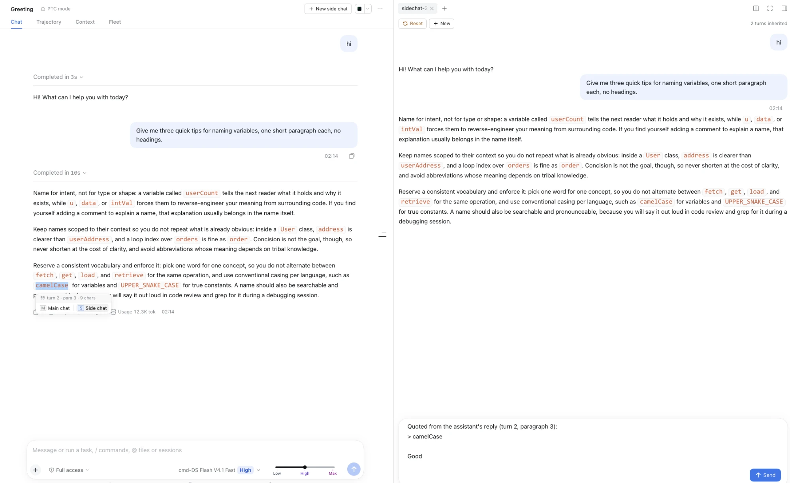

# dsh-annotate-sidechat

一个 DeepSeek Harness（DSH）Web 插件：**在 assistant 回复里划选文字，把带位置的引用发送到主对话或侧边对话**。

[English](README.md)

本插件是 [dsh-sidenote](https://github.com/g-yixuan/dsh-sidenote) 的简化版和修改版。

```
划选 assistant 回复  →  发送到主对话 / 发送到侧边对话
                        ├─ 主对话：引用内容追加到输入框
                        └─ 侧边对话：引用进入当前打开的 sidechat，没有就新建一个

在已发送的 sidechat 里划选回复  →  发送到此对话：引用进入该 sidechat 的输入框
```



> **状态：1.9.1**，支持 DeepSeek Harness `0.2.1-rc.2`、`0.2.1-rc.5` 以及 `0.2.2-rc.1` 至 `0.2.2-rc.5`（仅这七个宿主版本），已通过无头检查（`node check.mjs`）。
> 1.8.0 的模型和推理强度菜单已在 `0.2.1-rc.5` 的浏览器中看到；用它们发送侧边对话、1.7.0 的输入框改动，1.8.1 的页面记录修复，以及 1.9.0 的分支命名和输入法回车修复，尚未在浏览器中验证；`0.2.2` 上尚未做过任何浏览器验证；
> 哪些版本验证过见[依赖要求](#依赖要求)。

## 用法

- **划选** assistant 回复里的文字，选区下方弹出菜单，顶部标出位置（`第3轮 · 第2段 · 4字`）。
  按 `M` 发送到主对话、`S` 发送到侧边对话、`Esc` 关闭。在输入框里打字或按住修饰键时，按键不会被菜单接管。
- **引用**先用英文说明出处（无论界面语言，方便模型准确定位），再以块引用给出原文，下方留一个空行写你自己的话。
  模型靠原文本身定位，所以位置通常只写轮次。只有选中的文字在这段回复里出现不止一次时，才补上区分用的文字：
  所在块的开头几个字，表格单元格则是所在行和列标题。不写“第几段”这类序号，因为模型看到的是 Markdown，不是页面：

  ```
  Quoted from the assistant's reply (turn 3):
  > the selected passage

  Quoted from the assistant's reply (turn 3, in list item "需要 Node 18 或更高版本，并把 dsh…"):
  > Node 18
  ```

- **发送到主对话**：在主对话输入框里空一行后追加引用。
- **发送到侧边对话**：引用进入右侧栏当前打开的侧边对话，没有就新开一个。如果那个侧边对话是在被引用的轮次之前
  fork 的，菜单会先问你：发送到新的侧边对话，还是取消。
- **发送到此对话**（`S`）：在已发送的侧边对话里划选回复，引用进入该侧边对话自己的输入框。
- **`新建侧边对话`**（主对话顶栏，或右侧栏的添加按钮）打开一个不带引用的侧边对话。它左边的 `全部删除`
  不经确认，删除本对话的所有侧边对话。

## 侧边对话

- **发送时才创建。** 发送之前页面只是草稿，不存在任何对话。页面预览它将继承的已完成轮次（超过 4 KB 的消息，
  以及累计超过 24 KB 之后的内容不预览）。发送时在主对话最后一个已完成的轮次 fork，把子对话命名为
  `↳侧<n>·<主对话标题>`（英文界面为 `↳S<n>·…`），并把草稿作为第一条消息发出。失败时这次 fork 会被重新归档。
- **发送前选模型和推理强度。** `发送` 左边一个菜单按提供方列出宿主的模型，另一个列出所选模型的推理强度，两者默认都和主对话
  相同。在 Chromium 里，列表在页面内朝空间较大的一侧展开，一次显示全部选项，不用滚动；其他浏览器仍用系统菜单。换模型时，
  推理强度和主对话一样重置为新模型的默认值。fork 会沿用主对话的模型和推理强度，所以选择不变时什么也不写；选择不同
  时，插件在发出第一条消息之前把它设到 fork 上，和 DSH 里任何一次切换模型一样，这个选择也会成为宿主新建对话的默认模型。
  宿主已不提供的选择会显示为不可用，不会被换成别的模型：宿主拒绝你选的模型，或者设不上时，不会发送，并在页面上说明原因；
  没选模型时，无论如何都会按主对话的模型发送。`重置`，以及 `新建侧边对话` 复用一个空白页面时，都会恢复为主对话的设置。
  主对话的设置不受影响。
- **继承来的轮次默认折叠。** 每个页面都有工具栏：

  | 按钮 | 作用 |
  |---|---|
  | `重置` | 归档当前侧边对话；下次发送按主对话当前的样子重新 fork |
  | `删除` | 归档当前侧边对话（如果已发送），并关闭本页 |
  | `新建` | 为同一个主对话再开一个侧边对话 |
  | `继承 N 轮` | 显示或隐藏继承的轮次 |

- **在会话列表里紧跟主对话。** 左侧栏里，每个侧边对话的行显示在它的主对话下面，按编号排列。侧边对话的侧边对话同样排在它自己的主对话下面。某个侧边对话被归档或删除时，它的侧边对话上提一级，占住它原来的位置，再往上也依此类推；主对话本身被归档时，它的侧边对话留在宿主放的位置。宿主没有排序接口，列表底下仍是它自己的顺序，所以拖动排序和键盘导航还按宿主的顺序走。主对话被折叠进"显示更多"或在别的分组里时，侧边对话留在宿主放的位置。宿主不记录 fork 的来源，所以插件在发送侧边对话时记下它的主对话和编号（`localStorage`，`dsh-annotate-sidechat:parents`，各标签页共用）。更早发送的或在别的浏览器发送的侧边对话，会排到同一文件夹里标题与它所写主对话标题相同的那个对话下面；那里有两个对话同名时不动。如果那个主对话后来改了名，而同一文件夹里另有对话正好用了它的旧名，侧边对话会排到那个对话下面：宿主不提供创建时间或 fork 来源，没法区分。
- **分支也按同样的方式命名和排列。** 在回复下方用"Branch into a new conversation"或在会话菜单里用 Fork 建出的对话，标题改为 `↳分<n>·<主对话标题>`（英文界面为 `↳B<n>·…`），不再用宿主的 `<标题> (1)`。分支和侧边对话分开编号，插件会记下它的主对话，并把它排在主对话下面、该主对话的侧边对话之后。这个版本之前建的分支保留原名和宿主的顺序。改名失败时，分支保留宿主的标题，仍会排到主对话下面。
- **在别处归档或删除**（比如在会话列表里）后，侧边对话的页面会自行关闭。
- **刷新后仍在。** 每个页面在 `localStorage` 里保存一条小记录（`dsh-annotate-sidechat:tab:<sessionId>/<tabId>`：每个对话的侧栏都从同一个起点给标签页编号，单凭 tab id 并不唯一），页面关闭时删除。
- 已发送的侧边对话就是宿主自己的对话界面（`conversation.content`），渲染在插件的 `annotateSidechat.conversation` slot 里。

## 安装

对你的 DSH agent 说：

```
install the DSH bundle github:baicaihenxiao/dsh-annotate-sidechat
```

从本地克隆安装时改为给出路径：`install the DSH bundle at /absolute/path/to/dsh-annotate-sidechat`。之后刷新 Web 页面。

这是一个 profile 插件包：会作用于该 profile 的所有会话。卸载：让 agent 移除 bundle `dsh-annotate-sidechat`，
或在 DSH 的 Plugins 页面停用它。

## 更新

从 GitHub 安装会钉住安装当次解析到的 commit，所以上游新提交不会自动到来：

| 安装方式 | 更新办法 |
|---|---|
| `github:baicaihenxiao/dsh-annotate-sidechat` | `dsh plugin --profile <profile> update dsh-annotate-sidechat`，或先移除 bundle 再装一次 |
| 本地克隆目录 | 在克隆目录里 `git pull` |
| 指定 tag 或 commit | 安装你要的修订，如 `github:baicaihenxiao/dsh-annotate-sidechat#v1.9.1`（commit SHA 必须是完整 40 位） |

`dsh plugin` CLI 只装包，用完之后需要重新选中 bundle。更新后刷新 Web 页面。

## 依赖要求

| 插件 | DeepSeek Harness | 浏览器中验证过 |
|---|---|---|
| `1.0.0` – `1.1.0` | `0.2.0-rc.2` | `1.0.0` |
| `1.2.0` – `1.4.1` | `0.2.0-rc.2`、`0.2.1-rc.2` | `1.2.0`（两者）；`1.2.1`、`1.3.0`、`1.3.1`、`1.4.1`（`0.2.1-rc.2`） |
| `1.5.0` – `1.6.0` | `0.2.1-rc.2` | 仅 `1.6.0` 的引用位置说明 |
| `1.7.0` – `1.8.1` | `0.2.1-rc.2`、`0.2.1-rc.5` | `1.8.0` 的模型和推理强度菜单（`0.2.1-rc.5`） |
| `1.9.0` | `0.2.1-rc.2`、`0.2.1-rc.5`、`0.2.2-rc.1`、`0.2.2-rc.2` | 暂无 |
| `1.9.1` | `0.2.1-rc.2`、`0.2.1-rc.5`、`0.2.2-rc.1` – `0.2.2-rc.5` | 暂无 |

Node `^22.19.0 || >=24.0.0`。其余依赖都随 DSH 提供，本包自身不声明任何依赖。因为插件依赖宿主的内部接缝（见下），
`peerDependencies` 把宿主包精确钉在对应 DSH 版本，DSH 会拒绝在其他版本上安装。`0.2.0-rc.2` 上请安装 `#v1.4.1`。
若确需在未验证的宿主上使用，可以显式接受风险：

```sh
dsh plugin --profile <profile> allow-version dsh-annotate-sidechat@1.9.1 --dsh-version <runtime> --accept-risk
```

## 文件

| 文件 | 作用 |
|---|---|
| `client.js` | 全部功能：选区、引用、菜单、侧边对话页面、工具栏、折叠 |
| `index.js` | 宿主端，有意留空 |
| `cordis.patch.yml` | 插入插件条目，让客户端模块随之加载 |
| `package.json` | bundle 清单与 peer 包 |
| `check.mjs` | 无头检查 |

## 与宿主的衔接

| 宿主接缝 | 用途 |
|---|---|
| `[data-chat-flow-kind="assistant-step"]`、`[data-chat-turn]`、`[data-chat-group-part]` | 哪些内容可引用，以及位置说明 |
| `[data-conversation-session]`、`[data-sidebar-right-*]` | 选区属于哪个对话；侧栏里只有已发送的侧边对话可引用 |
| `[data-chat-flow-key]`、`[data-chat-flow-kind="user"]`、`ctx.sessions.binding().eventSource` | 继承的轮次到哪里为止，用于折叠 |
| `ctx.sessions.fork` / `retain` / `binding.session` / `list` | 创建、命名、持有侧边对话并给它编号 |
| 带 `increaseTitle` 的 `ctx.sessions.fork`（包在 `Symbol.for('cordis.original')` 背后的服务对象上）；`ctx.sessions.using` | 识别宿主建的分支，再给它命名并记下来；插件卸载时恢复宿主原来的 `fork` |
| `ctx.modelDirectories.directoryFor(id)`：`store`、`load`、`select`；`ctx.sessions.retainInfo` | 草稿的模型和推理强度菜单，以及把选择设到 fork 上；察觉主对话的会话绑定出现或更换 |
| `ctx.sidebarRight`、`ctx.sidebarRightTabs`、`sidebar.right.pane.tab(.title)` | 侧边对话页面类型与标签名；打开、显示和关闭页面 |
| `conversation.session.header.utilities` | 顶栏的 `新建侧边对话` 和 `全部删除` |
| 左侧栏的 `[data-row-key="session:<id>"]` | 把侧边对话的行显示在主对话下面 |
| `annotateSidechat.conversation` + `conversation.content` | 在面板里渲染宿主的对话界面 |
| `ctx.get('workspaces').list`、`ctx.get('uiWorkspace').archiveSession` | 识别在别处归档的侧边对话；重置、删除和发送失败时归档 |
| `ctx.conversation.input.for(scope).setDraft` / `focus` | 把引用写进输入框 |

宿主改名后，受影响的那一部分会降级（不出菜单，或面板里显示一行错误），而不会让页面崩溃。

## 检查

```sh
node check.mjs
```

检查还会把插件的 slot 注册放到宿主真实的 `SlotCore` 上重放。从 `0.2.1-rc.2` 起需要单独安装这个包，
并用 `DSH_SLOTS_MODULE` 指向它；没有时跳过这一步：

```sh
npm install --prefix /tmp/dsh-slots @deepseek-ai/dsh-client-ui-slots@$(dsh --version)
DSH_SLOTS_MODULE=/tmp/dsh-slots/node_modules/@deepseek-ai/dsh-client-ui-slots/lib/index.js node check.mjs
```

## 许可证

[MIT](LICENSE)
