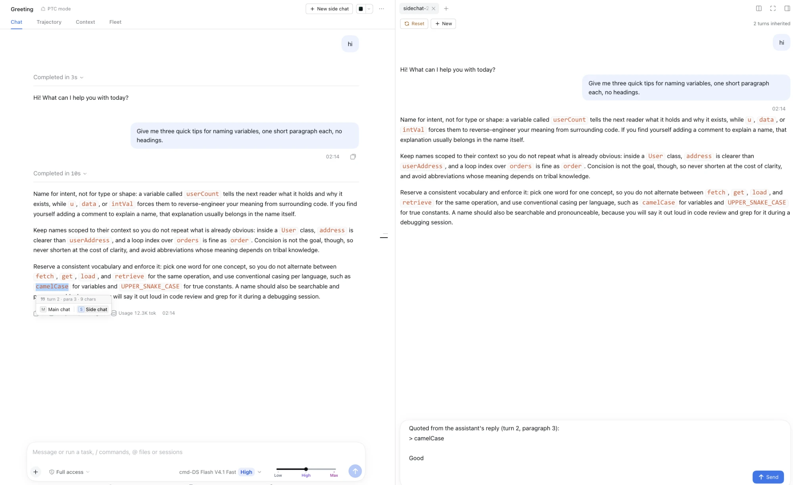

# dsh-annotate-sidechat

一个 DeepSeek Harness（DSH）Web 插件：**在 assistant 回复里划选文字，把带位置的引用发送到主对话或侧边对话**。

[English](README.md)

本插件参考 [dsh-sidenote](https://github.com/g-yixuan/dsh-sidenote)，是该插件的简化版和修改版。

```
划选 assistant 回复  →  两个选项：发送到主对话 / 发送到侧边对话
                        ├─ 主对话：引用内容追加到输入框（前空一行，末尾空一行，光标到位）
                        └─ 侧边对话：引用进入当前打开的 sidechat，没有就新建一个

在已发送的 sidechat 里划选回复  →  发送到此对话：引用进入该 sidechat 的输入框
```

左侧是主对话，选中一个词后弹出引用菜单；右侧是侧边对话 `sidechat-1`：展开显示继承的两轮、
创建它的那条引用及回复，以及输入框里等待发送的下一条引用。



> **状态：1.3.1 —— 已通过无头检查（`node check.mjs`，其中包括把插件的 slot 注册放到宿主真实的
> slot 注册表上重放），并在 DeepSeek Harness `0.2.0-rc.2` 和 `0.2.1-rc.2` 的浏览器页面上验证了引用菜单、
> 发送侧边对话、fork 点提示、Reset 和刷新；1.2.1 的折叠修复，以及 1.3.0 的菜单、快捷键和工具栏在 `0.2.1-rc.2`
> 上验证（浅色与深色）；1.3.1 的预览修复在 `0.2.1-rc.2` 页面上以模拟方式验证。侧边对话内的发送到此对话、
> 以及清理在别处归档的侧边对话，尚未在浏览器中验证。** 见[检查](#检查)。

## 功能

1. **划选**主对话中某条 assistant 回复里的文字，选区正下方会弹出一个两项菜单，顶部用界面语言
   用统一的简短写法标出选区位置（`第3轮 · 第2段 · 4字`，英文界面为 `turn 3 · para 2 · 4 chars`）。卡片宽度只由选项决定，
   位置说明放不下时以省略号结尾，悬停可看到完整内容。两项分别是 `主对话` 和 `侧边对话`（即下文的发送到主对话 /
   发送到侧边对话），每项前面是它的快捷键：菜单打开时按 `M` 发送到主对话、
   `S` 发送到侧边对话、`Esc` 关闭（单项菜单和第 4 条的提示用 `Enter` 确认）。在输入框里打字时，
   或按住 Ctrl、Cmd、Alt、Shift 时，按键不会被菜单接管；焦点停在某个按钮上时，`Enter` 仍归该按钮。
   非拉丁字母键盘布局（俄语、希腊语等）下，`M` 和 `S` 按键位识别。右侧栏里只有
   已发送的侧边对话可以引用（见第 8 条），各种控件和代码块的标题栏任何时候都不会被当作可引用的文字。
2. **发送到主对话**：把引用追加到主对话输入框的草稿里 —— 原有文字、一个空行、然后是引用。
   两个目标都会让草稿以一个空行结尾并把键盘交给输入框，光标停在新的一行，方便你接着写。
   引用超出输入框高度时，输入框会滚动到末尾，侧边对话自己的输入框和宿主的输入框都是如此
   （宿主聚焦时用了 `preventScroll`，所以由插件来滚动）。（菜单是一张单层描边的白色卡片：
   顶部浅灰标题栏标出位置，选项在其下方；弹出时淡入（系统开启「减少动态效果」时不淡入）；
   主选项的按键标签使用输入框发送键同款的浅蓝底。）
3. **引用带英文位置说明** —— 先说明引用的是对话中的哪个位置，再以块引用的形式给出原文：

   ```
   Quoted from the assistant's reply (turn 3, paragraph 2):
   > the selected passage
   > continues here
   <引用下方留一个空行，写你自己的话>
   ```

   位置说明在中文界面下也保持英文，方便模型准确定位。
4. **发送到侧边对话**：引用会进入右侧栏当前显示的侧边对话。一个都没打开时会新开一页；
   打开了多个时，由你正在看的那一页接收。该页还是草稿时，引用进入它的输入框；
   对话已经创建后，引用进入该对话自己的输入框。如果那个对话是在被引用的轮次之前 fork 的 ——
   比如它只继承到主对话第 2 轮，而引用来自第 4 轮 —— 它只会拿到这段文字而没有上下文，
   所以菜单会变成一段说明，先问你：`发送到新的侧边对话` 会新开一个带着这段引用的侧边对话页面
   （发送时从主对话最新完成的轮次 fork），`取消` 则什么也不发送。点击其他任何地方等同于取消。
5. **侧边对话不一定要有引用。** 右侧栏的引导入口（标签栏的添加按钮 / 空白栏）也提供这个页面。
   这样打开的侧边对话从一个空输入框开始，直接输入即可，*而且看起来就像一个已经发送过的侧边对话*：
   同样的工具栏（在已发送面板放折叠按钮的位置显示继承轮数）、一段可滚动的主对话原样记录，
   以及固定在下方、只占自身内容高度的输入卡片。这张卡片照搬宿主输入框（`InputBar`）的样式：
   面板圆角、输入区底色与柔和阴影、对话的字号与行高，以及主色填充的带文字矩形发送按钮
   （箭头图标 + 文字），右对齐放在卡片里。卡片本身是原来的两倍高（最低 172 px，最高占面板的 45%），
   放得下一段引用加一段回复；已经创建的侧边对话则保持宿主绘制的原样输入框。
   记录在自己的框内滚动，输入框不会盖住历史。记录里显示的就是新对话将要继承的内容 ——
   **当前屏幕上那个对话**已完成的轮次，在创建侧边对话时截取一次（读取按会话定位，
   切换对话不会把上一个项目的历史交给新的侧边对话），并以主对话自己的标记渲染
   （markdown、代码、版式），而不是压扁成摘要。这些标记再次显示前会先做无害化处理 ——
   去掉脚本、嵌入内容、事件处理器和 `javascript:` 链接，也去掉宿主的轮次与锚点标记，
   因为这些标记必须只在真实记录里唯一存在。这块区域打开时停在历史末尾，与已发送对话的记录一样，
   最新的轮次就在输入框正上方。预览随页面一起保存，所以有大小限制：标记超过 4 KB 的消息不预览
   （大多数 assistant 回复都会超过），从最新往前累计超过 24 KB 后更早的消息也不预览。有消息未预览时，
   最后一条预览消息之后会居中显示一条虚线分隔「较长的消息未在此预览」；发送后侧边对话渲染的是 fork 出的
   真实对话，所有消息都会完整显示。宿主对较长的对话按页加载历史，屏幕上可能只有最近的几轮：继承轮数取主对话
   最后一个已完成轮次的编号，而不是屏幕上显示的轮数（已发送页面同样按 fork 边界计数）；最早的轮次未加载时，
   预览顶部会居中显示一条虚线分隔「更早的轮次未在此加载」。
6. **对话在发送时才创建，而不是点击时。** 输入框发送之前，这个页面只是一份可编辑的草稿，
   会话列表里**不存在任何对话**。发送时会 fork 主对话（`sessions.fork` 不指定边界，
   由宿主截在主对话**最后一个已完成的轮次** —— 正在生成的轮次永远不会被继承），
   把子对话命名为 `sidechat-<n>-<主对话标题>`，并把草稿作为它的第一条消息发出。
   如果命名或第一条消息失败，这次 fork 会被重新归档，失败的发送不会在列表里留下一个
   没有页面关联的主对话副本；创建过程中发到该页的引用，会转到新对话自己的输入框里。
7. **继承来的记录默认折叠。** fork 会带上一份主对话的副本；面板里*本侧边对话第一条消息之前*
   的内容都会折叠，需要时才展开。（继承来的消息即使引用了同一处，也不会被误认为那条消息：
   匹配会越过共同的位置说明，并跳过 fork 继承的轮次。那条消息不在页面上时 —— 比如较早的侧边对话 ——
   改用 fork 的事件窗口给出的边界。）每个侧边对话页面都有自己的工具栏，从左到右：

   | 按钮 | 作用 |
   |---|---|
   | `重置`（刷新图标） | 归档当前对话，把本页恢复为空输入框；下次发送会 fork 一个新对话，因此输入框上方的继承记录会按主对话当前的样子重新获取（包括这期间新增的轮次）。描边按钮，文字使用主题的警示色（琥珀色），带提示文字 |
   | `新建`（加号图标） | 为同一个主对话再开一个侧边对话页面（可以同时打开多个）。描边按钮，文字为常规颜色，让「新增」一眼就和「警示」区分开 |
   | `继承 N 轮`（箭头） | 显示或隐藏 fork 继承的轮次；纯文字，固定在右侧，提示文字说明当前动作 |

   两个发送动作都会*显示*目标页面：折叠的侧栏会展开，页面会获得焦点，发送引用不会无声无息。
   侧栏暂时放不下页面时（切换会话后它的界面要稍等片刻才挂载），会在约 1.5 秒内重试打开；
   侧栏始终没有挂载时，会在菜单里报错，而不是什么都不做。发往某个侧边对话的引用，
   如果它的输入框约 5 秒内都没出现，菜单会带着错误重新出现，引用不会凭空消失。
8. **在侧边对话里引用。** 在已发送的侧边对话里划选某条回复的文字，会弹出只有一项的菜单
   `发送到此对话`（按键 `Enter`，上方同样标出位置），把带位置的引用追加到该侧边对话自己的输入框 —— 格式、空行和聚焦方式与另外两项相同。
   尚未发送的页面，以及其他侧栏聊天，都不会弹出菜单。
9. **在别处归档或删除。** 侧边对话同时也是一个普通会话，可以在会话列表里被归档或删除 ——
   比如在主对话区打开它之后。此时它的页面会被清理：一旦它的主对话显示在屏幕上就关闭
   （在那之前只显示一句说明，也不再持有这个已消失的对话），它的记录被删除，
   `发送到侧边对话` 也不会再把它当作目标。`重置` 自己的归档不会被误认为这种情况，该页仍照常重新开始。

侧边对话面板不是重新实现的：子对话创建后，面板声明自己的 `annotateSidechat.conversation`
子 slot，用框架的 `SessionProvider` 包起来，并在其中渲染宿主的 `conversation.content` factory ——
也就是 DSH 自带的对话界面，消息流和输入框都包括在内。（它不使用宿主的
`sidebar.chat.conversation`：内置的 subagent 侧栏聊天占用了这个单一 slot，slot 注册表不允许重复声明。）
面板里的文字就是宿主的 DOM：可以选中、可以复制；在其中某条回复里划选会弹出 `发送到此对话`（第 8 条），
侧栏里的其他内容都不会被引用。

插件不会往被引用的回复里写回任何东西。页面在存活期间把自身状态（侧边对话 id、编号、子对话、
边界、草稿、快照）放在导航参数里，同时在 `localStorage` 里为每个标签页保存一条小记录
（`dsh-annotate-sidechat:page:<tabId>`；标签页关闭时删除，加载时若已没有任何保存的布局包含该标签页
也会删除 —— 从不按时间清理，所以放了几周没打开的对话里的侧边对话，依然认得自己）。
侧栏会持久化布局，但不会持久化这些参数，没有这条记录的话，刷新后每个侧边对话都会变回空白的新页面。
页面挂载时，身份依次取自导航参数、这条记录，都没有时就新建一个侧边对话（即从引导入口打开的情况）。

## 安装

这是一个 **profile 插件包**：安装后会作用于该 profile 的所有会话。它没有发布到 npm，请从本仓库安装。

对你的 DSH agent 说：

```
install the DSH bundle github:baicaihenxiao/dsh-annotate-sidechat
```

agent 会调用 `plugin_manager` 的 `install_bundle`，把包加进 profile 并选中该 bundle。
之后刷新 Web 页面即可；只改了客户端时不需要重启 `dsh web`。

也可以从本地克隆安装：

```sh
git clone https://github.com/baicaihenxiao/dsh-annotate-sidechat
```

```
install the DSH bundle at /absolute/path/to/dsh-annotate-sidechat
```

卸载：让 agent 移除 bundle `dsh-annotate-sidechat`，或在 DSH 的 Plugins 页面停用它。

- 插件 `1.3.1` 面向 DeepSeek Harness `0.2.0-rc.2` 和 `0.2.1-rc.2`，两者都在浏览器中验证过。`peerDependencies`
  钉的就是这两个版本，因此 DSH 会拒绝在未经检查的宿主上安装或启用本 bundle —— 具体钉了哪些包见[依赖要求](#依赖要求)。

## 更新

从 GitHub 安装会把「安装当次解析到的 commit」钉在你的 profile `pnpm-lock.yaml` 里，
所以**上游新提交不会自动到来**。按你的安装方式选择更新办法：

| 安装方式 | 更新办法 |
|---|---|
| `github:baicaihenxiao/dsh-annotate-sidechat` | `dsh plugin --profile <profile> update dsh-annotate-sidechat`，或先移除 bundle 再装一次 |
| 本地克隆目录 | 在克隆目录里 `git pull` —— profile 链接的就是该目录 |
| 指定 tag 或 commit | 安装你要的修订：`github:baicaihenxiao/dsh-annotate-sidechat#v1.3.1` |

需要知道的几点：

- 用**同一个** spec 再装一次不会移动钉住的 commit；真正重新解析的是 `pnpm update`。
- `plugin_manager` 的 `install_bundle` 会「装包 + 选中 bundle」两件事一起做；而 `dsh plugin`
  这条 CLI 通道只装包，用完之后需要重新选中 bundle。
- 更新后刷新 Web 页面（或重启 `dsh web`）。
- 用 tag 固定版本：`#v1.3.1`；分支名也可以。若用 commit SHA，必须是完整 40 位 ——
  pnpm 无法解析缩写 SHA。
- 查看已装版本：

  ```sh
  cat ~/.dsh/profiles/<profile>/node_modules/dsh-annotate-sidechat/package.json
  ```

## 依赖要求

| 插件 | DeepSeek Harness | Node |
|---|---|---|
| `1.0.0`, `1.0.1`, `1.1.0` | `0.2.0-rc.2` | `^22.19.0 \|\| >=24.0.0` |
| `1.2.0`, `1.2.1`, `1.3.0`, `1.3.1` | `0.2.0-rc.2`, `0.2.1-rc.2` | `^22.19.0 \|\| >=24.0.0` |

- 一个 DSH Web profile。本插件依赖的东西都随 DSH 提供：右侧栏的页面注册表与
  `sidebar.right.pane.tab` 座位（`@deepseek-ai/dsh-client-ui-sidebar-right`）、`conversation.content`
  factory 与输入框状态机（`@deepseek-ai/dsh-client-ui-conversation`）、会话归档
  （`@deepseek-ai/dsh-client-ui-workspace`）以及语言包注册（`@deepseek-ai/dsh-client-locale`）——
  所以本包自身不声明任何依赖。
- 一个**已验证过的 DSH 版本**。`peerDependencies` 把上述四个宿主包钉在 `0.2.0-rc.2 || 0.2.1-rc.2`，`engines`
  与宿主的 Node 范围（`^22.19.0 || >=24.0.0`）一致。DSH 的插件管理器会把每个 `@deepseek-ai/dsh*`
  peer 范围**与 DSH 运行时版本**比对，不匹配则拒绝安装或启用（`incompatible-version`）——
  所以在未验证的宿主上是**明确报错**，而不是渲染出一个坏掉的侧边对话。本插件依赖宿主的内部接缝
  （见[与宿主的衔接](#与宿主的衔接)），这正是精确钉版本的原因。验证过的新宿主版本会追加到这里；
  若确需提前使用，可以授予**精确版本豁免**，即显式接受该风险：

  ```sh
  dsh plugin --profile <profile> allow-version dsh-annotate-sidechat@1.3.1 --dsh-version <runtime> --accept-risk
  ```
- `react` 与 `react-dom/client` 由浏览器模块表提供，除此之外不导入任何东西。

## 文件

| 文件 | 作用 |
|---|---|
| `client.js` | 全部功能：选区捕获、引用、菜单、侧栏页面类型、工具栏，以及继承前缀的折叠 |
| `index.js` | 宿主端 —— 有意留空，功能完全在客户端 |
| `cordis.patch.yml` | 插入插件条目，让客户端模块随之加载 |
| `package.json` | bundle 清单、`dsh.client` 声明、peer 包 |
| `check.mjs` | 无头检查：注册、引用与命名接缝、折叠边界、页面类型、标签名、未发送面板，以及在宿主真实 slot 注册表上的重放（`node check.mjs`） |

## 与宿主的衔接

| 宿主接缝 | 用途 |
|---|---|
| `[data-chat-flow-kind="assistant-step"]` | 判断哪些内容可引用：选区两端必须在同一条 assistant 回复里 |
| `[data-chat-turn]`、`[data-chat-group-part]` | 位置说明（轮次编号、推理还是回复） |
| `[data-conversation-session]` | 会话列表快照没有 `current` 时读取会话 id，并为快照挑出屏幕上那个会话自己的记录 |
| `[data-sidebar-right-*]` | 把侧栏里的选区排除在引用菜单之外，已发送侧边对话的主体除外（插件给它标上了子对话 id） |
| `ctx.sessions.fork` / `retain` / `binding.session` | 发送时创建子对话、重命名、发出第一条消息，并在页面存在期间一直持有它 —— 与宿主自带的侧栏聊天一样，而不只是页面显示时，所以在主对话区打开该侧边对话再切回来，面板下的会话不会被重新打开 |
| `[data-chat-flow-key]` / `[data-chat-flow-kind="user"]` | 在本侧边对话第一条消息处切开记录（事件窗口给出的轮次边界作为后备） |
| `ctx.sessions.binding().eventSource` | fork 继承了哪些轮次（子对话中与父对话 seq、类型、时间都相同、即原样复制来的事件），用于折叠；已发送页面每次打开时重新计算 |
| `ctx.sessions.list` | 给侧边对话编号，读取主对话标题 |
| `ctx.sidebarRight.openTab`（`replaceTab`）+ `active` / `mounted` / `isExpanded` / `focus` / `registerCloseHandler` | 每个侧边对话开一页（界面挂载期间重试）、原地改写页面参数、找到当前打开的那页、让它显示出来，以及忘掉已关闭的页面 |
| `ctx.sidebarRightTabs` + `sidebar.right.pane.tab(.title)` | 页面类型、页面主体，以及标明每个侧边对话的标签名 |
| `annotateSidechat.conversation`（自有子 slot）+ `conversation.content` factory | 在面板里渲染 DSH 自带的对话界面 |
| `ctx.sidebarRight.openTabs` + `close` | 删除已没有任何保存布局包含的页面记录，并关闭当前屏幕上对话里那些已在别处归档或删除的侧边对话页面 |
| `ctx.get('workspaces').list`（`archivedSessionIds`）+ `ctx.sessions.list`（`ids`、`phase`） | 判断侧边对话是否已在别处归档或删除 —— 只在两份列表都已就绪时判断 |
| `ctx.get('uiWorkspace').archiveSession` | `重置` 时归档被替换的对话，发送失败时归档那次 fork |
| `ctx.conversation.input.for(scope).setDraft` / `focus` | 把引用写进输入框并交出键盘 |

这些是内部接缝，不是公开约定：宿主改名后，受影响的那一部分会降级（不出菜单，或面板里显示一行错误），
而不会让页面崩溃。

## 检查

```sh
node check.mjs
```

覆盖 bundle 注册、引用与输入框草稿接缝、命名规则（`sidechat-<n>-<title>`，没有标题时用目录名）、
侧边对话编号、中英文 key 一致、页面类型注册（`multiple: true`、引导入口、标签名）、
从菜单打开与从引导入口打开两种情况下的未发送面板（重置在新建左侧，各有图标、样式类和提示文字 ——
重置是警示色 —— 以及占满输入卡片上方空间、在自身框内滚动的记录，
下方是按内容定高的输入卡片）、菜单的位置说明与按键标签、每个按键对应哪一项（组合键和输入框里的按键不被接管）、
主选项按键标签的强调色、继承前缀的折叠规则、不会被继承来的同位置引用
抢走的折叠边界、不把主对话在 fork 之后写入的 seq 算作继承的 fork 点（以及已发送页面修正存下的错误边界）、选中的回复引用到哪里（主对话、已发送的侧边对话；未发送页面里复制来的条目、
其他侧栏聊天和仍在生成的回复则不出菜单）、把引用交给该侧边对话的单项 `发送到此对话` 菜单，
引用晚于当前侧边对话 fork 点时弹出的说明（哪些轮次算晚于 fork 点、取消与发送到新侧边对话
两个选项，以及选区事件不会把它冲掉）、页面在关闭前一直持有它的侧边对话，以及对在别处归档或
删除的侧边对话的清理（列表就绪后才判断归档或缺失、当前屏幕上对话的页面关闭 —— 无论来自内存
还是记录 —— 其他对话的页面先放开子对话、重置不受影响，以及已消失的页面不渲染该对话的任何内容）。

检查还会把本插件的每一次 slot 注册放到宿主真实的 `SlotCore`（`@deepseek-ai/dsh-client-ui-slots`）
上重放，并与内置 subagent 侧栏聊天的注册放在一起，两种加载顺序都试 —— 上面的桩会接受一次重复声明，
而真实注册表会拒绝。`dsh` `0.2.0-rc.2` 把这个包装在 `dsh` 可执行文件旁边，经 `PATH` 即可找到；
`0.2.1-rc.2` 只把 `SlotCore` 打包进了 Web 应用，需要单独安装这个包，并用 `DSH_SLOTS_MODULE` 指向它：

```sh
npm install --prefix /tmp/dsh-slots @deepseek-ai/dsh-client-ui-slots@0.2.1-rc.2
DSH_SLOTS_MODULE=/tmp/dsh-slots/node_modules/@deepseek-ai/dsh-client-ui-slots/lib/index.js node check.mjs
```

两者都没有时会跳过这一步，并明确说明。

DOM 层另外用无头 Chrome 和一个临时脚手架跑过（未提交 —— 它需要本地 Chrome 和 `puppeteer-core`）：
两项菜单；侧栏里的选区不出菜单；侧栏里的 mousedown 不被拦截；`发送到主对话` 在一个空行后追加、
引用下方再留一个空行；聚焦输入框，并把被引用撑满的输入框滚到末尾；新对话面板带着与已发送面板
相同的工具栏；输入卡片按内容定高，上方记录在自身框内滚动，且是主对话原样的标记；发送按钮是靠右的矩形；
只统计已完成的轮次（正在生成的那一轮不算）；主对话继续增长时快照保持不变（之后新建的侧边对话
会截取更新后的状态）；没有页面时 `发送到侧边对话` 会打开一页；发送该页只 fork 一次，并把子对话命名为
`sidechat-1-Main chat title`，不指定边界（宿主的最后一个已完成轮次）—— 主对话继续往前走之后也一样；
重置与新建按钮各自带颜色样式类；继承的条目会被标记并折叠（按位置和按轮次后备两种方式都试过），
切换按钮可用；再次引用会进入已打开侧边对话的输入框而不是再开一页，并让该页显示出来（展开 + 聚焦）；
`重置` 归档子对话并把页面恢复为获得焦点的空输入框；`新建` 打开第二个页面，带自己的 id 和编号；
一次被拒绝的打开会重试，最终只开出一页；侧栏始终不挂载时在菜单里报错。
这个脚手架并没有处处复现真实宿主的时序：折叠标记以前会在对话主体挂载之前运行，
这会让真实页面上的切换按钮始终出不来（已修复）。

1.0.0 另外在真实的 DSH `0.2.0-rc.2` Web 页面上手动验证过：从引用发出的侧边对话和从引导入口打开的
侧边对话都会渲染 DSH 自带的对话界面；控制台没有 slot 注册表报错，内置的 subagent 侧栏聊天仍然正常；
继承轮次的切换按钮会出现，并折叠正确的条目；刷新后页面仍认得自己的侧边对话；
再次引用会进入已有侧边对话的输入框。

1.2.0 以同样方式在 `0.2.0-rc.2` 和 `0.2.1-rc.2` 两个 Web 页面上验证过（由本地模拟模型应答）：
两者都无需版本豁免即可安装；两个菜单项、发送侧边对话、继承轮次切换按钮、分叉点提示、Reset、刷新，
以及再次引用进入已发送侧边对话的输入框均正常。在 `0.2.1-rc.2` 上，发到主对话的引用还会保留输入框里
已有的命令标签（`/goal`）。

1.2.1 在真实的 `0.2.1-rc.2` Web 页面上验证过，对象是主对话某一轮仍在运行时 fork 出的侧边对话：
用 1.2.0 存下的边界时，它自己的第一轮被折进「继承自主对话 3 轮」；页面重新计算后显示 2 轮，
侧边对话自己的那一轮保持可见，修正后的边界写回了页面，刷新后保持不变。

1.3.0 在真实的 `0.2.1-rc.2` Web 页面上以浅色和深色两种外观验证过：菜单顶部的位置说明条
（`turn 1 · para 2 · 6 chars`）与下方带按键标签的选项、卡片宽度与选项行一致、`M`、`S` 和 `Esc`，
俄语键盘布局下按键位识别的 `M`（同一键位上的逗号不触发任何选项），以及描边的重置、新建按钮和继承轮次说明。
单项的 `发送到此对话` 菜单、它在位置说明过长时的省略号，以及 fork 点提示，只做了无头检查和页面内的模拟。

1.3.1 在真实的 `0.2.1-rc.2` Web 页面上，通过改动主对话的行来模拟各种情况进行验证：Reset 重新获取主对话的历史
（创建页面时隐藏一轮，Reset 前再显示出来）、按轮次编号计算继承轮数以及预览顶部的「更早的轮次未在此加载」
（把行改编为更后面的轮次）、最后一条消息之后的「较长的消息未在此预览」，以及消息全部过长的预览。
真正分页加载的主对话和已发送侧边对话的折叠按钮计数，只做了无头检查。

## 许可证

[MIT](LICENSE)
